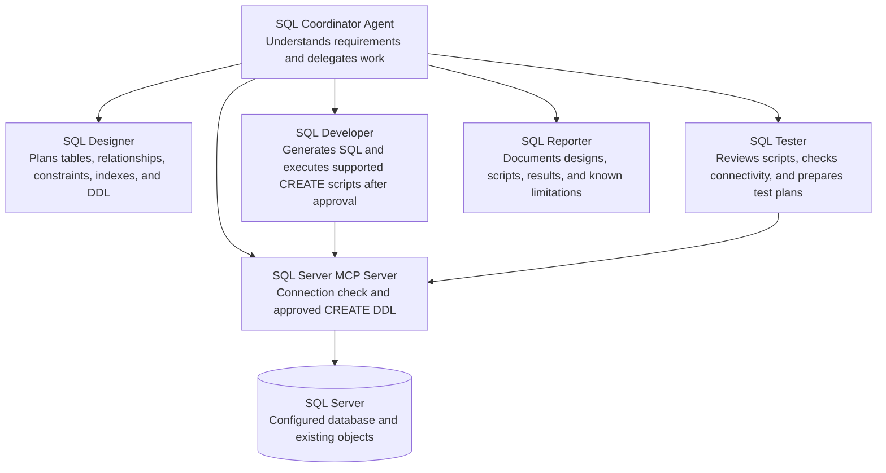

# SQL Server Agentic

A Node.js Model Context Protocol (MCP) server that connects an MCP-compatible
client, such as Visual Studio Code, to SQL Server. A workspace agent team
coordinates SQL design, implementation, validation planning, and reporting.

## Architecture



The coordinator routes work to specialist agents and consolidates their
evidence-based results. Database access goes through the MCP server; only its
connection check and explicitly approved `CREATE` statements are currently
available.

## Requirements

- Windows
- Node.js
- SQL Server and a database the Windows account can access
- Microsoft ODBC Driver 18 for SQL Server

The configured driver uses Windows integrated authentication. The Windows
account running the MCP server must have the required SQL Server permissions.

## Setup

1. Install the project dependencies from the repository root:

   ```powershell
   npm install
   ```

2. Create a `.env` file in the repository root:

   ```dotenv
   SQL_SERVER=localhost\SQLEXPRESS
   SQL_DATABASE=YourDatabase
   ```

   Set `SQL_SERVER` to your SQL Server host and, if applicable, named instance.
   Set `SQL_DATABASE` to an existing database. `.env` is excluded from Git.

3. Ensure SQL Server accepts TCP/IP connections. For a named instance using a
   dynamic port, SQL Server Browser may also need to be running and reachable.
   Configure the firewall to allow the SQL Server listener and, when needed,
   SQL Server Browser.

4. Open the repository as a workspace in Visual Studio Code. The
   `.vscode/mcp.json` configuration starts `src/index.js` as the `sqlserver`
   MCP server and loads settings from `.env`. Start or restart the MCP server
   after changing its configuration.

## Available MCP tools

### `test_connection`

Connects to the configured database and reports its current database and server
names. It does not modify the database.

### `execute_ddl`

Executes a `CREATE` statement for a supported SQL Server object: table, view,
procedure, function, index, or schema. The caller must provide the exact
approval phrase `CONFIRM CREATE`.

The tool checks that the statement starts with a supported `CREATE` keyword.
This check is a convenience guard, not a replacement for appropriate SQL
Server permissions. Use a database account with only the permissions the
application needs.

The current MCP server does not expose general query execution, data
modification, or stored-procedure execution. The SQL Tester can review scripts
and prepare test plans, but cannot run those tests against the database.

## Workspace agent team

Select **SQL Coordinator** in Visual Studio Code for tasks that need
orchestration. It can delegate to these specialist agents:

- **SQL Designer** — plans schema, relationships, constraints, indexes, and DDL.
- **SQL Developer** — writes SQL and runs supported `CREATE` statements only
  after the user approves the exact SQL with `CONFIRM CREATE`.
- **SQL Tester** — reviews scripts, checks connectivity, and prepares test
  plans; it does not execute general queries or stored procedures.
- **SQL Reporter** — documents designs and results based on available evidence;
  it does not query live database contents.

The agent definitions live in `.github/agents/`. The SQL Coordinator and
specialists use the tools currently exposed by this project's MCP server; they
do not bypass those tool limitations. The SQL Tester can check connectivity and
prepare test plans, but cannot execute general queries or stored procedures.
The SQL Reporter documents supplied or workspace evidence; it cannot query live
database contents.

Automatic subagent delegation uses the VS Code **Local** agent harness. Other
harnesses may let you select the agent profiles individually but may not support
the coordinator's `agents` configuration.

## Connection and TLS notes

The server uses the `mssql` package with its `msnodesqlv8` driver, Windows
integrated authentication, and ODBC Driver 18. Encryption is enabled. The
connection string also sets `TrustServerCertificate=yes` to support local or
self-signed SQL Server certificates.

Trusting the server certificate skips certificate validation. This can expose
connections to server impersonation, so for production use a certificate
trusted by the client and configure the connection to validate it instead.

If connection setup fails, check that:

- `SQL_SERVER` and `SQL_DATABASE` are correct and the database exists.
- The SQL Server service is running and TCP/IP is enabled for the instance.
- The Windows account running VS Code can connect to the database.
- The instance's TCP port is reachable; named instances may use dynamic ports.
- ODBC Driver 18 is installed and the server's certificate configuration is
  compatible with the TLS settings.

## Project layout

- `src/index.js` — MCP server, SQL connection configuration, and tool handlers.
- `.vscode/mcp.json` — Visual Studio Code MCP server configuration.
- `.github/agents/` — SQL Coordinator and specialist agent instructions.
